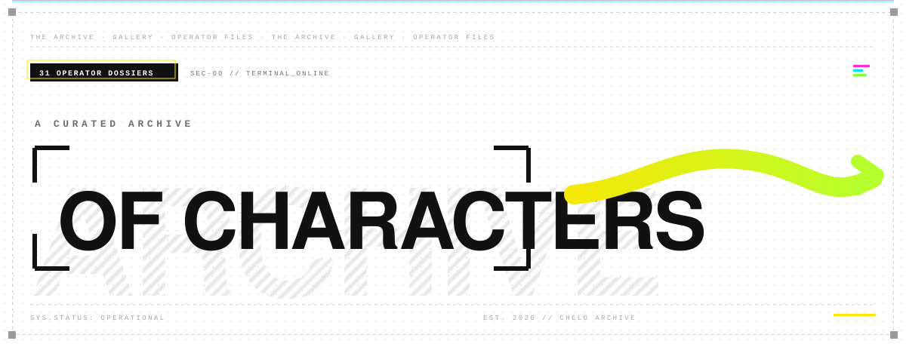
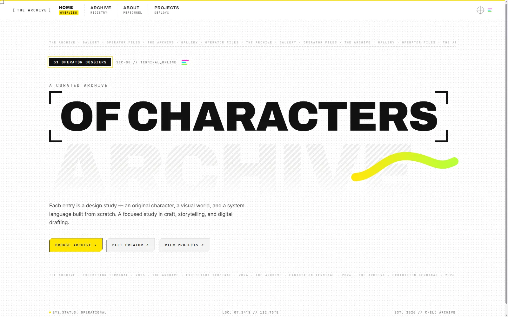
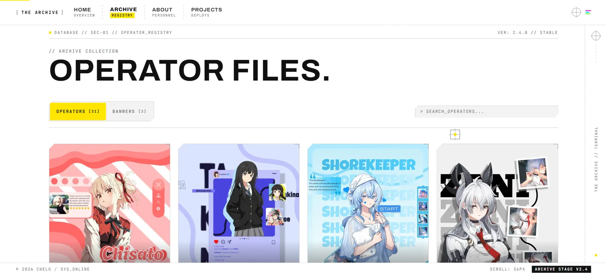
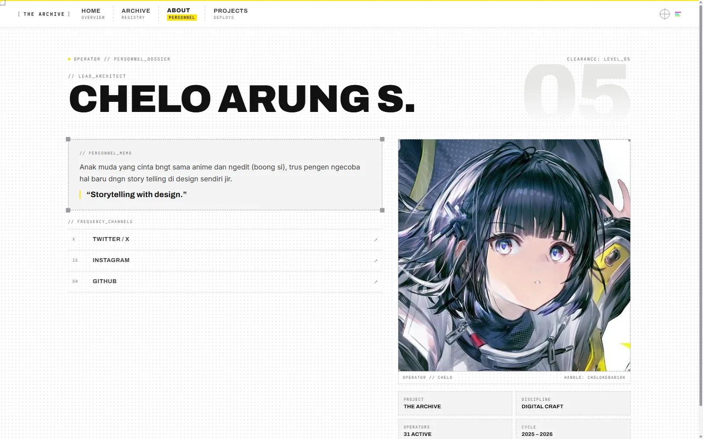
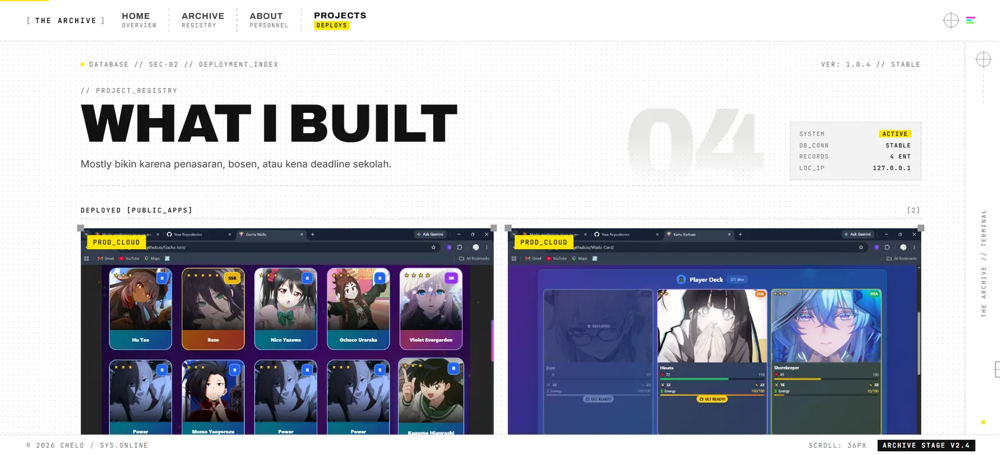
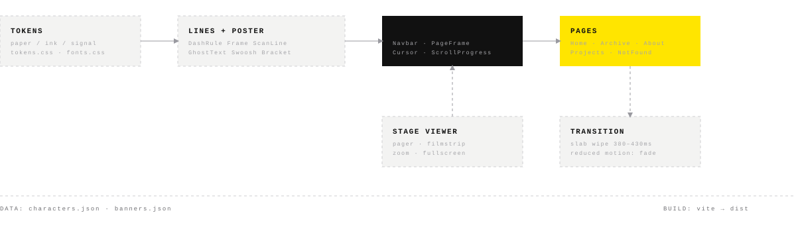
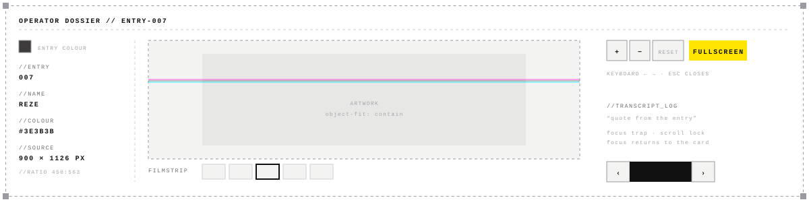

<p align="center">
  
</p>

<p align="center">
  <a href="https://www.cheloarchive.my.id/"><b>[ ENTER THE ARCHIVE ↗ ]</b></a>
  &nbsp;·&nbsp;
  <a href="docs/DESIGN.md">Design system</a>
  &nbsp;·&nbsp;
  <a href="docs/LINES.md">Line motion</a>
  &nbsp;·&nbsp;
  <a href="docs/TASKS-V2.md">Rework spec</a>
</p>

<p align="center"></p>

## 01 // Overview

**The Archive** is the personal portfolio of Chelo (Greeezzz): original and fan character designs, banner graphics, and software projects, presented as an **exhibition terminal**.

Most pages are calm and paper-white, built from precise dashed linework, corner handles, and tiny mono labels, so the artwork stays the hero. At key moments (home hero, 404, route transitions) the site switches to a loud yellow/black **poster mode** with bracket titles, giant type, and a swoosh.

Every character is a "dossier": it has an entry number, a quote, a colour swatch, real image metadata, and a shareable link (`/archive?entry=007`).

## 02 // Screens

| Home · poster mode | Archive · operator registry |
|:--|:--|
|  |  |
| **About · personnel dossier** | **Projects · deployment index** |
|  |  |

## 03 // Two visual modes

| Mode | Where | Feel |
|---|---|---|
| **Console** | Archive, About, Projects, stage viewer | Quiet, hairline dashed grid, tiny mono labels, art is the hero |
| **Poster** | Home hero, 404, page transitions | Yellow/black slabs, bracket titles, giant type, swoosh, glitch slivers |

Motion is part of the design: dashed dividers draw themselves, frames pop their corner handles, a scan line sweeps the art when an entry changes, and route transitions wipe via dual yellow/black slabs. All of it falls back to a static layout with `prefers-reduced-motion`.

## 04 // Architecture & flow

<p align="center">
  
</p>

## 05 // Stage viewer anatomy

<p align="center">
  
</p>

## 06 // Stack

<p align="center">
  
</p>

- **Styling:** plain CSS, one file per component, shared tokens in `src/styles/tokens.css`
- **Motion:** `motion/react`
- **Type:** Archivo (variable display), Inter (body), JetBrains Mono (labels and code)

## 07 // Project structure

```
src/
  components/
    lines/          DashRule, Frame, ScanLine, GhostText, Crosshair, TopoLines, DrawLine
    poster/         BracketTitle, Swoosh, MicroTextBand, SlabLabel, GlitchSlivers
    motion/         DecodeText, Reveal
    ui/             Button, Tag
    Navbar          console header (tabs + dashed dividers)
    PageFrame       right rail + bottom status bar
    StageViewer     full-screen entry viewer (filmstrip, zoom, pan, fullscreen)
    CharacterCard, BannerCard, Cursor, PageTransition, BackToTop, ScrollProgress
  data/             characters.json, banners.json
  lib/              color.js, motion.js
  pages/            Home, Archive, About, Projects, NotFound
  styles/           tokens.css, lines.css, poster.css, fonts.css
public/             characters/, banners/, projects/, profile/, fonts/
scripts/            image optimization & responsive srcset generators
docs/               PRD, DESIGN, LINES, MOTION, TASKS-V2, AGENTS, assets, screenshots
vercel.json         SPA client-side routing rewrite
```

## 08 // Run it

```bash
npm install      # install
npm run dev      # dev server
npm run lint     # eslint
npm run build    # production build
npm run preview  # preview the build
```

## 09 // Adding a character

1. Drop the artwork in `public/characters/` as `.webp`.
2. Run `bash scripts/optimize-images.sh` (resizes masters to max 900px) and `bash scripts/make-responsive-variants.sh` (generates 480px mobile variants).
3. Append an entry to `src/data/characters.json` (use the next free `id` and `number`):

```json
{
  "id": 32,
  "number": "032",
  "name": "CHARACTER NAME",
  "quote": "Character voice line.",
  "image": "/characters/archive_32.webp",
  "color": "#E5A93C",
  "category": "archive",
  "isWiderDesign": false
}
```

The grid, search, pager, chapter grouping, entry count, and ghost numerals all read from that file. Nothing else to edit.

> **Colour rule:** the entry's `color` never colours text or hairlines (several entries are white or light gray and would vanish on paper). It only appears as a fill behind art, an edge strip, or a chip next to ink text. Details in [`docs/DESIGN.md`](docs/DESIGN.md).

## 10 // Docs

The build specs live in `docs/`. Read them in this order:

`AGENTS.md` → `PRD.md` → `DESIGN.md` → `LINES.md` → `MOTION.md` → `TASKS-V2.md`

First-generation design docs are kept in `docs/v1-archive/`.

<p align="center"></p>

## 11 // Rights

© 2026 Chelo (Greeezzz). Original artwork, layouts, and designs are all rights reserved; please ask before reusing them. Fan designs depict characters owned by their respective rights holders and are shown as non-commercial design studies. The source code is public for reference.
